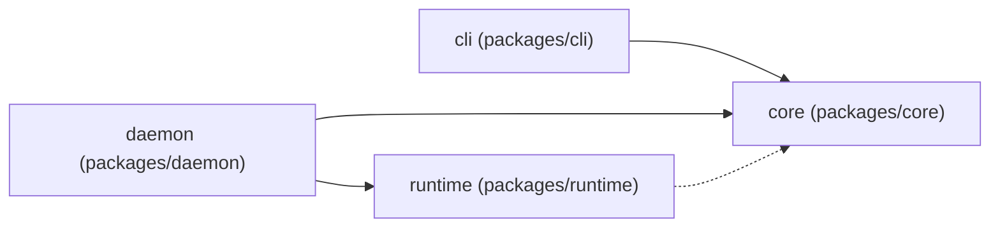
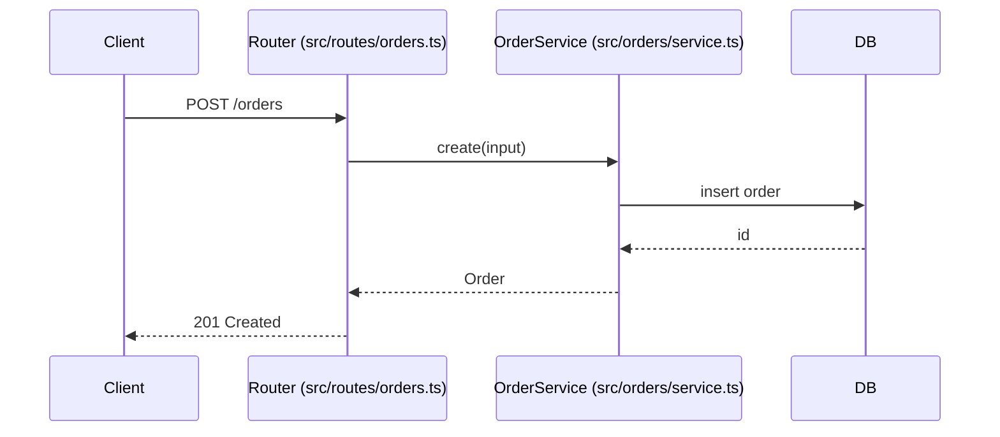

# Diagrams

Read when adding or updating a Mermaid diagram in architecture docs.

## Rules
- Every node maps to a real module, package, service or path; put the path in the
  label or a note below the diagram.
- Every arrow maps to an import, call, message, route or config entry you can cite.
- At most about 12 nodes; split by boundary rather than shrinking labels.
- One diagram, one question: structure, a request path, or deployment. Not all three.
- Label arrows with the protocol or verb when it is not obvious.
- No styling, colours or icons unless the project's docs already use them.
- Regenerate from code when the boundary changes; delete a diagram nobody maintains.
- Unverified edges use a dotted arrow and an "Unverified" note.

## Flowchart: module dependencies

Note: the dotted edge marks an import seen only in tests (Unverified for runtime code).

## Sequence: one request path

## Container view (C4-like, using a flowchart)

## Checking a diagram
- For each node, confirm the path exists.
- For each edge, find the import, call or config line; cite it in the surrounding text.
- Render it with the project's docs tooling if available; otherwise check syntax by eye
  against these examples and keep it simple.
