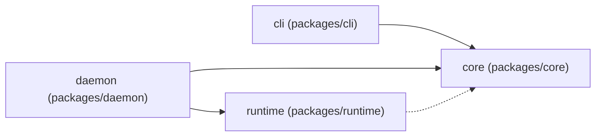
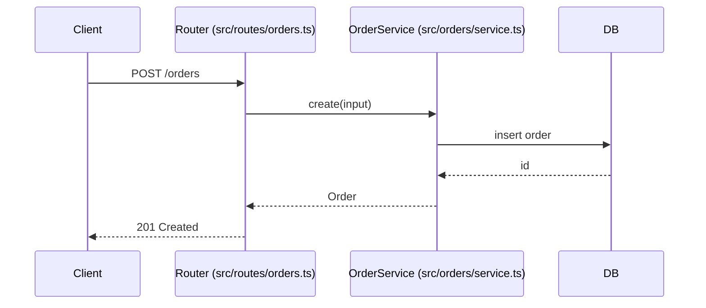
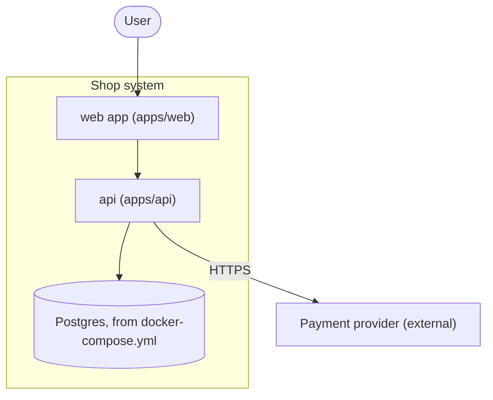

# Sơ đồ

Đọc khi thêm hoặc cập nhật một sơ đồ Mermaid trong tài liệu kiến trúc.

## Quy tắc
- Mỗi node ứng với một module, package, service hay đường dẫn thật; đặt đường dẫn vào
  nhãn hoặc vào một ghi chú bên dưới sơ đồ.
- Mỗi mũi nối ứng với một import, lời gọi, message, route hay mục config mà bạn dẫn nguồn được.
- Nhiều nhất khoảng 12 node; hãy tách theo ranh giới chứ đừng thu nhỏ nhãn.
- Một sơ đồ, một câu hỏi: cấu trúc, đường đi của một request, hoặc cách triển khai. Không gộp
  cả ba.
- Ghi nhãn mũi nối bằng protocol hoặc động từ khi điều đó không hiển nhiên.
- Không tô kiểu, màu hay icon trừ khi tài liệu của project đã dùng chúng.
- Sinh lại từ code khi ranh giới đổi; xoá sơ đồ không ai bảo trì.
- Các cạnh chưa kiểm chứng dùng mũi nối nét đứt kèm ghi chú "Unverified".

## Flowchart: phụ thuộc giữa các module

Ghi chú: cạnh nét đứt đánh dấu một import chỉ thấy trong test (Unverified với code runtime).

## Sequence: đường đi của một request

## Góc nhìn container (kiểu C4, vẽ bằng flowchart)

## Kiểm một sơ đồ
- Với mỗi node, xác nhận đường dẫn tồn tại.
- Với mỗi cạnh, tìm dòng import, lời gọi hay config; dẫn nó trong phần chữ xung quanh.
- Render bằng công cụ tài liệu của project nếu có; nếu không thì soi cú pháp bằng mắt dựa trên
  các ví dụ này và giữ sơ đồ đơn giản.
